# Warm Heritage Frontend Redesign - final plan (milestone v2.2.5)

This supersedes the earlier draft plan file (`warm_heritage_frontend_redesign_c7e0d899.plan.md`). Decisions fixed: tenants may change only the accent color and the logo; milestone runs before v2.3; no backend, schema or new npm dependency (fonts via `@fontsource` and a DOM test library are ask-first items).

## 1. Final solution (definition of the finished state)

Look and feel
- Warm stone page background, white surfaces with 1px hairline borders, radius 8-10px, no resting shadows (elevation only for modals, popovers, toasts).
- Heebo for UI; a Hebrew serif display face (Frank Ruhl Libre) only for page titles, the Hebrew date, parasha and the bulletin.
- Signature details: thin bronze rule under page titles and section heads; Dashboard "today" strip (Hebrew date, parasha, candle lighting, next prayer) instead of a stat-card grid; light stone sidebar with a bronze edge on the active item instead of a filled pill.
- Data first: dense tables, sticky headers, tabular numerals, semantic status badges. Motion 120-180ms, honoring `prefers-reduced-motion`.

Token contract (`frontend/src/index.css`, in `@theme`, verified against Tailwind v4 docs via Context7)
- Surfaces and lines: `bg` #FAF8F5, `surface` #FFFFFF, `line` #E7E5E4. Text: `ink`, `muted`, `primary` #172554, `primary-hover`. Accent: `accent` #B45309 for fills and rules; `accent-ink` = `color-mix(in oklab, var(--color-accent) 70%, black)` for text. Status: `success`, `warning`, `danger`, `info`, each with soft background and AA text pair. Radius, one popover shadow, type scale, `--font-display`.
- Temporary aliases in plain `:root` (not `@theme`): `--color-indigo` and `--color-gold`; removed in F8.
- `applyTheme` in `AppConfigContext.tsx` writes only `--color-accent` and the logo; `TenantConfig` columns untouched.
- Redefining `--radius-*` and `--shadow-*` changes built-in `rounded-*`/`shadow-*` app-wide; every page is rechecked in F1.

Components (`frontend/src/components/ui/`)
- Existing props stay valid (`Button` `variant|size|loading`, `PageHeader` `title|subtitle|action`, `Card` family, `EmptyState`, `Modal`, `Badge`, `Input`, date pickers); changes are additive.
- New: `DataTable`, `Tabs`, `Toast`, `Skeleton`, `StatCard`, `Num` (tabular numerals, LTR isolate), `Ltr` (phones, emails, IDs).
- Function components with `import type`; no `React.FC`; no hardcoded hex, no `bg-[var(--x)]`, no raw `gray|slate|zinc|stone` classes.

RTL and accessibility
- Global `dir="rtl"` untouched; logical utilities only (no `text-left/right`, `flex-row-reverse`, `space-x-reverse`, `pl/pr/ml/mr`).
- AA contrast for token pairs (computed in F1, recorded, not assumed); visible focus ring; 44px touch targets under 768px; no horizontal scroll at 375/768/1280.
- Every page: `PageHeader`, `EmptyState` per empty list, loading and error states, `Toast` for every action.

Enforcement
- `npm run design:status` (counts per file, always exit 0) and `npm run design:check` (exit 1 on any violation), added in F0, required by the definition of done.

## 2. Self-check protocol (after every subtask)

1. In `frontend/`: `npm run lint`, `npm run build`, `npm test` all pass.
2. `npm run design:status`: total never increases; files declared migrated report 0.
3. Playwright MCP checks: `browser_resize` to 375x812, 768x1024, 1280x800; `browser_take_screenshot` of each touched screen; `browser_snapshot` for roles and labels; `browser_press_key` for Tab and Escape; `browser_console_messages` shows no errors; `browser_evaluate` asserts `scrollWidth <= innerWidth`. Preconditions: backend (`uvicorn main:app --reload`), `npm run dev`, and an admin test login.
4. Update the subtask `Status:` line and the Status view below.
5. Two failed fix attempts on the same check: stop and report (per `AGENTS.md`). Do not commit unless asked.

Baseline (matching lines under `frontend/src`): hex colors 86; raw `gray|slate|zinc` classes about 490; physical-direction classes about 26.

## 3. Execution flow

```mermaid
flowchart LR
  docs0[F0a_Docs_and_roadmap_now] --> base[F0b_Baseline_tooling]
  base --> tokens[F1_Tokens]
  tokens --> prims[F2_Primitives]
  prims --> gate1[Gate_1_Design_review]
  gate1 --> newp[F3_New_primitives]
  newp --> shell[F4_Shell_Login]
  shell --> gate2[Gate_2_Design_review]
  gate2 --> pages[F5_F6_F7_Pages]
  pages --> clean[F8_Cleanup]
  clean --> docs9[F9_Final_docs]
```

## 4. Subtasks

### F0a. Docs and roadmap (first action after approval)
Status: pending
- `ROADMAP.md`: add status row `2.2.5 | Frontend redesign (Warm Heritage) | Pending` between 2.2 and 2.3, and a v2.2.5 section listing F0-F9 as unchecked items.
- `docs/ROADMAP_HE.md`: mirror the same milestone in Hebrew (required by the ROADMAP rule).
- `docs/agent/frontend.md`: add a short "Redesign in progress (v2.2.5)" note under the design section: target tokens, tenant-accent-only rule, and that new UI code uses the new tokens once F1 lands. The full design-section rewrite happens in F9 so docs never describe code that does not exist.
- Self-check: the English and Hebrew roadmap list the same items; no other doc claims the new design is already implemented.

### F0b. Baseline and status tooling
Status: pending
- `frontend/scripts/design-status.mjs` (Node only): scans `src/**/*.{ts,tsx}` for hex colors outside `index.css`, `(gray|slate|zinc|stone)-\d+`, `\b(pl|pr|ml|mr)-\d`, `text-left|text-right|flex-row-reverse|space-x-reverse`, `bg-\[#`, `bg-\[var(`; prints per-file counts and total. Add `design:status` and `design:check` to `package.json`.
- Run lint, build, test; record baseline; take baseline screenshots of all pages (outside the repo).
- Exit: baseline reproduced by the script; all checks green before any redesign change.

### F1. Tokens and fonts
Status: pending
- Tokens in `@theme`, aliases in `:root`, focus-ring and reduced-motion base rules, display font in `frontend/index.html`, `applyTheme` change.
- Ask first: `@fontsource`; verify font docs with Context7 then.
- Remove unused HSL variables only after confirming nothing reads them (`border-color: hsl(var(--border))` depends on `--border` today).
- Self-check: all pages still render; contrast ratios computed and recorded here (all AA); `color-mix` verified with `getComputedStyle` for a dark and a light tenant accent.

### F2. Restyle existing primitives
Status: pending
- `Button` (plus `accent`), `Card` family, `PageHeader` (display font, bronze rule), `Input`, `Badge`, `Modal`, `EmptyState` (no icon-in-circle), `DatePickerField`, `CalendarDatePicker`; no hardcoded hex.
- Self-check: build proves no prop contract broke; touched files report 0; every variant, disabled, loading and keyboard focus state screenshotted.

### Gate 1 - design review (blocks F3)
- I present screenshots of every primitive and a sample page at 375/768/1280. You approve or request changes (palette, typography, density). Direction changes are cheap here and expensive after page migration.

### F3. New primitives and tests
Status: pending
- `DataTable`, `Tabs`, `Toast` (provider and `useToast`), `Skeleton`, `StatCard`, `Num`, `Ltr`.
- Tests run in Node with `react-dom/server` (`renderToStaticMarkup`) asserting classes, `disabled`, `aria-*`, `dir`; no new dependency. `jsdom` plus Testing Library only if you approve.
- Self-check: tests pass; `Toast` uses `role="status"`; sticky header and keyboard behavior verified in the browser; Context7 check for React 19 portal and focus details.

### F4. Shell and Login
Status: pending
- `Sidebar.tsx`, `Header.tsx`, `Layout.tsx` (drawer under 1024px), `Login.tsx`; logout via `Button`.
- Self-check: `admin` and `gabai` navigation unchanged and `congregant` still blocked; drawer closes on Escape and outside click and returns focus; tested with a long synagogue name and a missing logo.

### Gate 2 - design review (blocks F5-F7)
- Screenshots of the shell, Login and Dashboard skeleton for approval before the 11 pages are migrated.

### F5. Pages A: Dashboard and Congregants
Status: pending
- Dashboard "today" strip and `StatCard`s; Congregants on `DataTable` (split into table, detail panel, forms; about 100 raw-class lines).
- Per-page checklist (F5-F7): `PageHeader`; `EmptyState`; loading and error; `Toast` per action; no raw `button/table/input` where a shared component exists; `Num` for money and times; `Ltr` for phones and emails; 375/768/1280 verified.
- Self-check: files at 0; flows still work (create, edit, archive, restore, bulk-delete); red bulk-delete bar readable (pitfall in `docs/agent/frontend.md`).

### F6. Pages B: Payments, Aliyot, Azkarot, Smachot
Status: pending
- Read `docs/agent/domain-gotchas.md` first. Self-check: Hebrew date display and azkarot/smachot ordering unchanged; money columns use `Num`; four files at 0.

### F7. Pages C: Seating, Calendar, PrayerSchedule, Bulletin, Chat, Import
Status: pending
- Read `docs/agent/prayer-schedule.md` first. Keep dnd-kit drag and drop (Seating, rule editor), seat numbering, the three bulletin formats and A4 print CSS.
- Self-check: drag and drop works; bulletin print preview is A4; calendar grid correct in RTL; six files at 0.

### F8. Cleanup and enforcement
Status: pending
- Remove aliases and leftover references; `design:check` passes; full accessibility pass (focus order, AA spot checks, touch targets, reduced motion).
- Self-check: `design:check` exit 0 with total 0; lint, build, test green; final screenshots compared with the F0b baseline; no `--color-indigo`, `--color-gold` or hex outside `index.css`.

### F9. Final docs
Status: pending
- `docs/agent/frontend.md`: replace the "Modern Gabay" section (tokens, fonts, radius and shadow, new components, tenant accent rule, `design:check`) and remove the in-progress note.
- `.cursor/skills/modern-ui/SKILL.md` and `examples.md`: new palette and principles; drop the example hardcoding `bg-[#2E3A59]`. `.cursor/rules/modern-ui.mdc` stays a pointer.
- `AGENTS.md`: update the Frontend colors hard rule; add `npm run design:check` to the definition of done.
- `ROADMAP.md`: tick all v2.2.5 items, row `Done`; mirror in `docs/ROADMAP_HE.md`. `docs/ARCHITECTURE.md`: edit only if it mentions the old palette.
- Self-check: grep docs for `#2E3A59`, `#C5A059`, `--color-indigo`, `--color-gold` (no stale references); English and Hebrew roadmaps match.

## 5. Status view (updated after each subtask)

- F0a docs: pending
- F0b baseline: pending (hex 86, gray-family about 490, physical direction about 26)
- F1 tokens: pending
- F2 primitives: pending
- Gate 1: pending
- F3 new primitives: pending
- F4 shell and login: pending
- Gate 2: pending
- F5 / F6 / F7 pages: pending
- F8 enforcement: pending
- F9 final docs: pending

## 6. Risks and ask-first items

- Large diff; suggested review chunks: F0-F2, F3-F4, F5, F6-F7, F8-F9. Commit only when asked.
- Ask before: `@fontsource`, `jsdom`/Testing Library, any `TenantConfig` cleanup.
- Not yet verified: font loading approach and React 19 portal/focus details (Context7 during F1 and F3); contrast values (computed in F1).