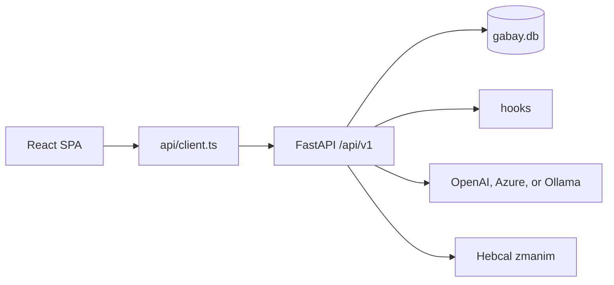
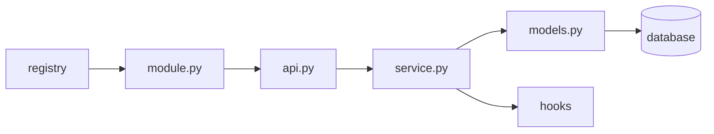
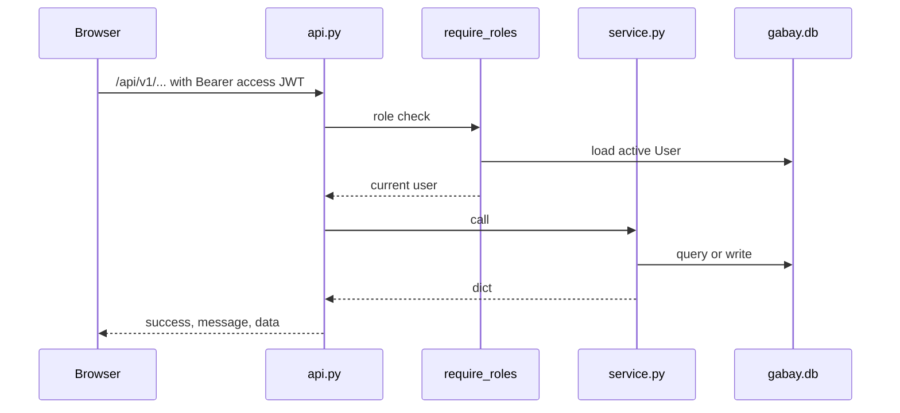
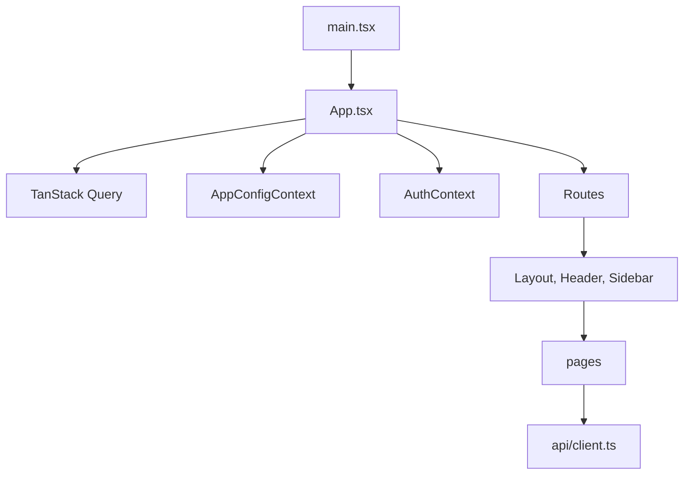

# Current architecture

What the process does today. The intended system, including `super_admin`, `/platform`, `/settings`, the audit log, Module Catalog, WhatsApp, and ECS, is [`../ARCHITECTURE.md`](../ARCHITECTURE.md). Live milestone status is `ROADMAP.md`. The reader map is [`README.md`](README.md).

## Shape

Gabay is a modular monolith. One FastAPI process and one React app. SQLite is the default database (`gabay.db`). PostgreSQL is the production target and is selected by `DATABASE_URL`.

Roles in code: `admin`, `gabai`, `congregant`. The web shell allows `admin` and `gabai`. `congregant` is a scoped API principal. `super_admin` is not implemented.

## Startup

1. `main.py` imports each `app/modules/<slug>/module.py`.
2. Each `module.py` registers a `ModuleDefinition` (id, display name, router, icon, nav path).
3. `registry.get_enabled(settings.ENABLED_MODULES)` returns the modules this install may mount.
4. Enabled routers are included under `/api/v1`. `app/api/v1/config.py` is mounted beside them.
5. `create_db_and_tables` runs `SQLModel.metadata.create_all`, a short list of legacy `ALTER TABLE` statements, and `_ensure_module_enabled("bulletin")`.

The slug list must match in three places:

| Place | Field |
|---|---|
| `main.py` | module imports |
| `app/core/config.py` | `ENABLED_MODULES` |
| `app/core/tenant.py` | `ALL_MODULES` |

Current slugs: congregants, payments, aliyot, seating, azkarot, smachot, calendar, llm, prayer_schedule, auth, bulletin.

A new module also needs a test file. An existing database row does not pick up a new slug on restart alone. That is why bulletin has the backfill in `app/core/db.py`.

## One module

`api.py` calls the service and does not touch the database. `service.py` owns the models and may fire events. Modules do not import each other. A cross-module id is a string. The exception is `User.congregant_id`, which is a real foreign key.

Calendar and llm have no `models.py`. They still follow `api.py` to `service.py`.

Responses use `{ success, message, data }` from `app/models/base.py`.

Authorization is checked in the router with `require_roles`, then again in the service. LLM tools are chosen by scope and checked again at dispatch. A congregant query filters on `congregant_id` in the database. Hiding a button is not a security boundary.

## Request path

Public surface used before login: `GET /api/v1/config` for branding, and the auth routes for register, login, refresh, and logout. `PATCH /api/v1/config` is admin. Domain routers require an operational `admin` or `gabai`.

Login is implemented. The access token is held in memory by `AuthContext`. Refresh uses the auth API. This is separate from the planned Settings page and `/platform` panel.

## Frontend

Server data goes through TanStack Query and `client.ts`. The two contexts hold auth and tenant config. They are not a second cache for module records.

`GET /api/v1/config` returns branding and the enabled-module manifest. The sidebar renders chat, dashboard, then enabled modules, and always appends Import. Routes in `App.tsx` are declared in code. They are not registered from the manifest.

| Route | Page | Module |
|---|---|---|
| `/login` | Login | auth |
| `/` | Dashboard | several |
| `/congregants` | Congregants | congregants |
| `/import` | Import | congregants CSV |
| `/payments` | Payments | payments |
| `/seating` | Seating | seating |
| `/aliyot` | Aliyot | aliyot |
| `/azkarot` | Azkarot | azkarot |
| `/smachot` | Smachot | smachot |
| `/calendar` | Calendar | calendar |
| `/schedule` | PrayerSchedule | prayer_schedule |
| `/bulletin` | Bulletin | bulletin |
| `/chat` | Chat | llm |

Shared components live in `frontend/src/components/ui/`. Pages use `PageHeader`. An empty list uses `EmptyState`. Colors are the CSS variables `--color-indigo`, `--color-gold`, and `--color-bg`. `dir="rtl"` is global.

## Data

SQLModel models are the tables. Alembic has two revisions: the initial schema, and adding the `gabai` role. Later tables, including `bulletin_config` and `bulletin_week_overrides`, are created by `create_all` on startup. New schema changes are supposed to go through Alembic. The procedure is `docs/agent/backend.md`.

Congregants are archived, not hard-deleted. Bulk removal is `POST .../bulk-delete` with ids.

Hebrew dates go through `app/core/hebrew_date.py`. Zmanim go through `app/core/zmanim.py` and the Hebcal API.

## Settings tiers

Three tiers. They stay separate.

| Tier | Where | Who changes it | Examples today |
|---|---|---|---|
| Install | `.env` via `app/core/config.py` | deploy | database URL, JWT, CORS, `ENABLED_MODULES`, LLM and zmanim defaults, rate limits |
| Synagogue | `TenantConfig` row, `/api/v1/config` | admin API | name, logo, colors, enabled modules |
| Module | that module's own tables and screens | gabai, inside the module | prayer rules, bulletin header and week overrides |

The Settings page, LLM fields on `TenantConfig`, and a code-level Module Catalog are target design. They are described in [`../ARCHITECTURE.md`](../ARCHITECTURE.md).

## Events

Modules notify each other only through `app/core/hooks.py`. A service fires an event. Another module registers a listener at import time. The firing module does not import the listener.

The target event list (payments listening to congregants, WhatsApp reminders, bulletin asking every module for a section) is in [`../ARCHITECTURE.md`](../ARCHITECTURE.md). Check `hooks.register` in the module you are changing before assuming a listener exists.

## Tests

`tests/conftest.py` builds an async client. Module behavior has a matching file: `test_congregants`, `test_payments`, `test_aliyot`, `test_places` (seating), `test_azkarot`, `test_smachot`, `test_calendar`, `test_prayer_schedule`, `test_bulletin`, `test_auth`. Cross-cutting files cover authorization, config, CSV import, LLM scope, rate limit, and congregant scope.
