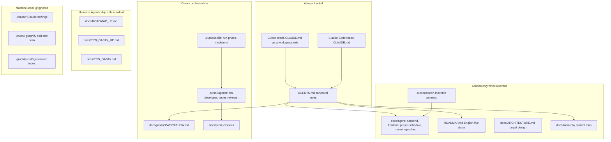
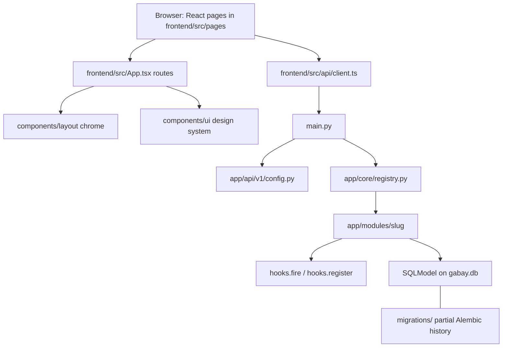

# Gabay hierarchy

Start here. This folder is the repo map: who loads which file, how the running app is shaped, and where the long text lives.

| Document | What it answers |
|---|---|
| This file | High level: readers, app layers, copies that are intentional |
| [`DETAIL.md`](DETAIL.md) | Annotated file tree |
| [`ARCHITECTURE.md`](ARCHITECTURE.md) | What runs today |
| [`../ARCHITECTURE.md`](../ARCHITECTURE.md) | Target design, including pieces that are not built |

Snapshot checked against the tree on 2026-11-02. `ROADMAP.md` is the live status. Do not treat this folder as a second roadmap.

## Who reads what

Antigravity has no project entrypoint. There is no `GEMINI.md`, `.gemini/`, or `.antigravity/`.

Claude Code and Cursor share one rule file. `CLAUDE.md` is the single line `@AGENTS.md`. The long rules stay in `AGENTS.md`.

## App layers

Browser: pages under `frontend/src/pages`, all routed from `frontend/src/App.tsx`. Shared chrome is `components/layout`. The design system is `components/ui`. Only `frontend/src/api/client.ts` calls the API. Contexts are auth and tenant config only.

API: `main.py` mounts `/api/v1/config` plus whatever `app/core/registry.py` enables. The same slug list is kept in three places: the imports in `main.py`, `ENABLED_MODULES` in `app/core/config.py`, and `ALL_MODULES` in `app/core/tenant.py`.

Slugs: congregants, payments, aliyot, seating, azkarot, smachot, calendar, llm, prayer_schedule, auth, bulletin.

Each module is `api.py` to `service.py` to `models.py`, except calendar and llm, which have no tables. Cross-module talk is `hooks.fire` / `hooks.register`.

Data: SQLModel on `gabay.db`, plus a partial Alembic history in `migrations/`. Startup also runs `SQLModel.metadata.create_all`.

## Page to module

One page maps to one module, with three exceptions.

| Page | Route | Backing |
|---|---|---|
| Dashboard | `/` | several modules |
| Congregants | `/congregants` | congregants |
| Import | `/import` | congregants CSV. Hardcoded in the sidebar. Not its own module |
| Payments | `/payments` | payments |
| Seating | `/seating` | seating |
| Aliyot | `/aliyot` | aliyot |
| Azkarot | `/azkarot` | azkarot |
| Smachot | `/smachot` | smachot |
| Calendar | `/calendar` | calendar |
| PrayerSchedule | `/schedule` | prayer_schedule |
| Bulletin | `/bulletin` | bulletin |
| Chat | `/chat` | llm |
| Login | `/login` | auth |

Operational routes sit behind `ProtectedRoute` for `admin` and `gabai`. Login is public.

## Copies that are the design

These look repeated. They stay split.

| File | Role |
|---|---|
| `CLAUDE.md` | One line: `@AGENTS.md`. Claude and Cursor share it. Do not merge the two files |
| `AGENTS.md` | The only always-on rule text |
| `.cursor/rules/*.mdc` | Short Cursor globs that point at `docs/agent`. The long text lives once |
| `docs/product/WORKFLOW.md` | The process |
| `.cursor/skills/run-phase/SKILL.md` | The short `/run-phase` checklist |
| `.cursor/agents/*.md` | Role prompts. They point at the workflow and the specs |
| `ROADMAP.md` | English status agents read |
| `docs/ROADMAP_HE.md` | Longer Hebrew history. Agents skip it unless asked |
| `docs/PRD_GABAY.md` and `docs/PRD_GABAY_HE.md` | Bilingual product spec. Agents skip both unless asked |
| `docs/ARCHITECTURE.md` | Target design |
| `docs/hierarchy/` | Current map. This folder |

`.codex/skills/graphify` and `graphify-out/` are local Codex and graphify caches. Both `graphify-out/` directories are gitignored by `**/graphify-out/`. A second copy of the graphify skill also sits in the user Claude skills folder and is not the same bytes. Leave both. Delete a local `graphify-out/` anytime to free disk.

## Real drift

These are actual mismatches, recorded so the next cleanup does not rediscover them. This folder does not fix them.

| Item | Current fact |
|---|---|
| `modern-ui` skill | `.cursor/rules/modern-ui.mdc` is a thin pointer to `docs/agent/frontend.md`. `.cursor/skills/modern-ui/SKILL.md` still carries its own palette text, and `examples.md` shows hardcoded hex and raw JSX |
| `/pm` | `docs/product/WORKFLOW.md` says to run `/pm`. The role prompt is `.cursor/agents/pm.md`. The skill that exists is `/run-phase`. There is no `.cursor/skills/pm/` |
| Claude mirror | Subagents and skills live under `.cursor/`. `.claude/` has settings only, so Claude Code does not see those role prompts as native agents |
| Graphify location | `AGENTS.md` tells agents to use graphify. The skill in this repo is under gitignored `.codex/skills/graphify/`, which Cursor and Claude Code do not load as a project skill |
| Plan file | `.cursor/plans/warm_heritage_frontend_final_8497efef.plan.md` is tracked. `WORKFLOW.md` says plans stay uncommitted. The plan's own status can lag `ROADMAP.md` |
| `mcp.json` | `.cursor/mcp.json` is tracked. `WORKFLOW.md` says to keep it out of git when it holds keys |
| Bulletin schema | Tables are `bulletin_config` and `bulletin_week_overrides`. Alembic versions do not create them. Startup uses `create_all`, then `_ensure_module_enabled("bulletin")` on an existing tenant row |
| `RoleGate` | Exported from `frontend/src/components/auth/ProtectedRoute.tsx` and not used by a page |
| Public assets | `frontend/public/` has `favicon.svg` and `icons.svg`. The sidebar also requests `/logo.png`, which is not in `public/` |

Resolved against an older file list: `install.cmd`, `clear_db.py`, and `frontend/verify_playwright.js` are not in the tree. `.cursor/rules/` has four pointer files (`backend`, `modern-ui`, `prayer-schedule`, `domain-gotchas`), not one.
