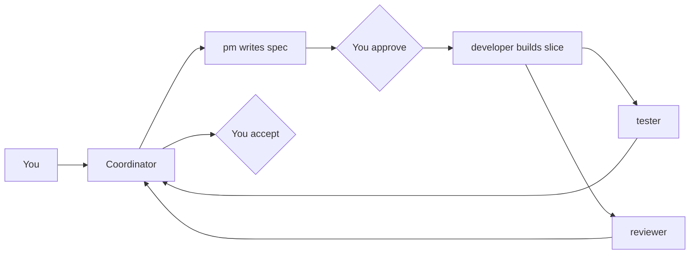
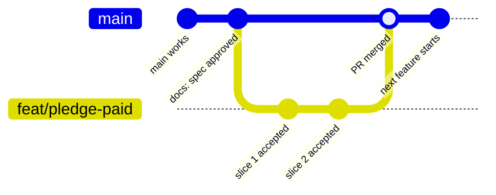

# Owner guide

How you, the owner, run Gabay. This guide is for you. The full procedure the agents follow is in [WORKFLOW.md](WORKFLOW.md).

## Your role as owner

You are the customer, the product manager, the developer, the tester and ops. You do not do these jobs at the same time. You separate them by time slot (plan, build, review), and work is handed over through files, not chat history.

You work through one chat, the **coordinator**. It calls the role agents for you. You make these decisions, and no agent makes them for you:

1. **Priority**: what to build next.
2. **Spec approval**: no code is written before you approve the spec.
3. **Risky changes**: database schema, sign-in and permissions, and new dependencies.
4. **Acceptance**: you try the feature the way a gabai would, then decide to ship it, fix it or drop it.
5. **Git**: agents commit and push only when you ask.

## The product

Gabay is a synagogue management system for gabbaim: congregants, payments, aliyot, seating, yahrzeits, simchot, calendar, prayer schedule, weekly bulletin, and a Hebrew assistant that operates the system. It has four user layers: `super_admin` (planned), admin, gabai and congregant.

A **feature** is the product unit. A **version** (phase) is only the delivery cut. Each spec names its phase in its `Roadmap item` field.

| File | Question it answers |
|---|---|
| `docs/PRD_*` | Why does the product exist, and who is it for? |
| `ROADMAP.md` | What is the status of each phase? |
| `docs/product/BACKLOG.md` | What is waiting, and in what order? |
| `docs/product/specs/<feature>.md` | What exactly are we building, and when is it done? |
| `docs/product/DECISIONS.md` | Why did we choose X? |
| `CHANGELOG.md` | What shipped, in plain language? |

## Project roles (agents)

The role files are in `.claude/agents/`. Cursor and Claude Code both read them. The `/run-phase` skill is in `.claude/skills/run-phase/`.

| Role | Job | Can edit |
|---|---|---|
| coordinator | The main chat. It calls the roles and passes results along | everything, when you allow it |
| `pm` | Challenges the request, writes and slices the spec, updates the backlog and decisions | `docs/product/` and `CHANGELOG.md` when asked |
| `developer` | Builds one approved slice, with its tests | code and tests |
| `tester` | Checks the slice against the spec's acceptance criteria | read-only |
| `reviewer` | Checks the diff against the hard rules in `AGENTS.md` | read-only |

The agents do not talk to each other. The coordinator briefs each one with the spec path, the slice, the acceptance criteria and the files in scope.

### Models

Models change often, so this guide names strength tiers, not model versions. Pick whatever model is currently at that tier.

| Role | Tier | Effort | Why |
|---|---|---|---|
| coordinator and `pm` | Strongest | High | Judgment, challenging the request, slicing |
| `developer` | Strongest | High for schema, auth or money slices; medium otherwise | Correctness matters most |
| `tester` | Strong | Medium | Mostly mechanical; test output is the evidence |
| `reviewer` | Strong or strongest, **never the same model as the developer** | High | Independent eyes on architecture and authorization |

- **Why different:** a model reviewing its own kind of work shares its blind spots.
- **Context:** standard context is enough. Each agent starts fresh with only the spec and the files in scope. When a chat gets long, start a new one instead of buying a bigger context window.
- **In the agent files:** `pm` and `developer` say `inherit` (they use your main chat model). `tester` and `reviewer` use the strong-tier alias (today `sonnet`). Claude Code moves the alias to new versions by itself. Change these lines only if the tiers above change.
- **Cursor:** for a review by another model family, say so when you call it, for example "run the reviewer with a non-Claude model".
- Keep your main chat on the strongest model. If it is the same as the `reviewer` alias (`sonnet`), `developer` (`inherit`) and `reviewer` would collide, so the coordinator passes a different model to `reviewer`.
- Slices that touch sign-in, permissions, money or the schema always get the independent reviewer.
- If the reviewer and the developer disagree, the coordinator brings it to you. It does not pick a side.

---

## Section 1: The flow so far

1. **Setup.** The four role agents, the `/run-phase` skill, the workflow section in `AGENTS.md`, the `docs/product/` files and `CHANGELOG.md` were created and pushed to GitHub (`botbole/gabay`, `main`).
2. **Shipped work documented.** Every feature that shipped before this workflow (v1 to v3.0 steps 0-3) now has a spec with status `done`. There are 12: congregants, payments, aliyot, seating, azkarot, smachot, calendar, dashboard, llm-assistant, prayer-schedule, weekly-bulletin and auth.
3. **Past decisions** were added to `DECISIONS.md`. The one real gap left, email sending for the bulletin, is backlog row B-005.
4. **Nothing was rebuilt**, and the roadmap status was not changed.
5. **Claude Code support.** The role files and `/run-phase` were moved from `.cursor/` to `.claude/`, so both tools find them.
6. **Waiting for you.** Two specs are still `draft`: `pledge-paid.md` (B-001, phase v2.3) and `assistant-chat-history.md` (phase v2.2.6).

## Section 2: From now on, with subagents



### Roadmap vs backlog vs spec

| File | Role |
|---|---|
| `ROADMAP.md` | The plan by phase. Updated when a phase finishes, or when you add a big item to a phase. |
| `BACKLOG.md` | Ranked waiting line for ideas, bugs and gaps. Picking one means build it, not move it into the roadmap. |
| `specs/<feature>.md` | Definition of done for one feature. Required unless the item is a small bug or a trivial change. |

Rules and triage live in `docs/product/WORKFLOW.md`. This guide is how you operate them.

### Steps for every change

1. **Log it.** A new idea, bug or gap becomes a row in `BACKLOG.md` (type `idea`, `bug` or `gap`), with a phase when known. No spec yet. Items already listed under a `ROADMAP.md` phase can skip this.
2. **Pick one.** Choose one backlog row or one item already in a `ROADMAP.md` phase. Both are valid sources.
3. **Spec (when needed).** Small bugs and trivial changes skip this (see the triage table in `WORKFLOW.md`). Otherwise `pm` writes the spec with status `draft`, cut into slices of one or two days.
4. **Approve.** You read it, answer the schema, sign-in and money questions, and set the status to `approved`.
5. **Build one slice.** `developer` writes the code and that slice's tests together.
6. **Check.** `tester` and `reviewer` run in parallel. If they find problems, the slice goes back to `developer`. After two failed rounds, the coordinator stops and reports to you.
   - **Second reviewer** (only for slices touching sign-in, permissions, money or the schema): before committing, run the reviewer on a model from another company and paste its report back. Fixes count toward the same two rounds.
7. **Gabai pass.** You use the feature on realistic data and decide: accepted, fix or drop. Write the result in the spec's "Gabai pass" section.
8. **Close the slice.** A changelog line, plus a decision entry if a real choice was made. Then commit and push. The next slice starts at step 5.
9. **Phase done.** Mark the phase done in `ROADMAP.md` only when every item in it is finished.

Ideas, bugs and gaps that come up during steps 5 to 8 go to the backlog. They do not change the current slice. Bugs found by `tester` or CI inside the current slice go back to `developer`, not to the backlog.

### Who does what

| Step | Who | What you type |
|---|---|---|
| Add an idea | You | "Add to the backlog: reminder list for unpaid pledges" |
| Add a bug | You | "Add a bug to the backlog: payment form shows no error when amount is empty" |
| Write a spec | `pm` | "Use the pm agent to write a spec for B-001" |
| Approve | You | Edit the spec, then "The spec is approved, decisions: ..." |
| Build, test, review | coordinator, `developer`, `tester`, `reviewer` | `/run-phase docs/product/specs/pledge-paid.md` |
| Second reviewer (risky slices) | You, in Cursor with a non-Claude model, or in Antigravity | Cursor: "Run the reviewer agent with model X on the current diff for slice 1 of `docs/product/specs/pledge-paid.md`". Antigravity: "Read `.claude/agents/reviewer.md` and follow it exactly on `git diff` for that slice. Do not edit files." Then paste the report into the main chat |
| Gabai pass | You | Use the app, then "Slice 1 accepted" (or "fix: ...") |
| Commit and push | You ask, the agent does it | "Commit and push this slice" |
| New chat | You | "Continue slice 2 of `docs/product/specs/pledge-paid.md`" |

### Prompt flow

Two chats. Copy one block. Replace the angle brackets.

**Log an idea, bug, or gap** (short chat, or edit `BACKLOG.md` yourself). Does not change `ROADMAP.md`.

```text
Add to the backlog: <idea, bug, or gap>.
Do not change ROADMAP.md.
Do not commit unless I ask.
```

**Chat 1 — spec** (`pm`). The backlog row already exists.

```text
Use the pm agent.
Item: <B-00x> (already in BACKLOG.md).
Read that row and its phase in ROADMAP.md.
Write docs/product/specs/<feature>.md as draft.
List decisions I must answer.
Do not add roadmap phases or new backlog ideas.
No code. Do not commit unless I ask.
```

After you approve:

```text
The spec is approved. Decisions: <answers>.
Commit the spec on main and push.
```

**Chat 2 — one slice** (new chat, after the spec is on `main`).

```text
Spec: docs/product/specs/<feature>.md (approved).
Slice: <number>.
Branch: feat/<name> from up-to-date main.
Run /run-phase for this slice only.
Do not start the next slice.
Do not commit, push, or open a PR unless I ask.
```

After you use the app:

```text
Slice <number> accepted.
```

or `fix: <what to change>`.

Then, only when you want it on GitHub:

```text
Commit and push this slice on feat/<name>, then open a pull request to main.
```

**After the PR is merged on GitHub** (you, in the terminal — not an agent prompt). Slice 2 of the same feature stays on `feat/<name>`. A new feature starts only after this:

```powershell
git switch main
git pull
git branch -d feat/<name>
```

### Weekly rhythm

1. **Plan** (30-60 min, start of week): pick 1-3 items, get the specs, approve them. No coding.
2. **Build** (rest of week): one slice at a time.
3. **Review** (30 min, end of week): gabai pass, then update `CHANGELOG.md` and `DECISIONS.md`, and push. Every 2-3 weeks, show the product to a real gabai.

### Git: main, feature branches and GitHub

There are three places your code lives:

| Place | What it is | Rule |
|---|---|---|
| `main` | The working version of Gabay | Always works. No direct coding on it |
| `feat/<name>` | A side branch for one feature, for example `feat/pledge-paid` | All code for that feature goes here, one commit per accepted slice |
| GitHub (`origin`, `botbole/gabay`) | The online copy and backup | Every push lands here; pull requests merge into `main` here |



Feature cycle, with what you type:

1. **Start the feature.** "Create branch `feat/pledge-paid` from an up-to-date `main`."
2. **Each accepted slice.** "Commit and push this slice." The agent shows `git status`, commits only the slice's files, and pushes the branch to GitHub. Never commit mid-slice, with failing tests, or `.env` and `gabay.db`.
3. **Feature finished.** "Open a pull request from `feat/pledge-paid` to `main`." On GitHub, read the changes in the pull request, then merge it.
4. **Clean up.** "Switch to `main`, pull, and delete the feature branch."

Small rules:

- Approve and commit the spec on `main` before creating the feature branch, so `developer` finds it there. Other docs-only changes (backlog, decisions) can go straight to `main`, or ride with the slice.
- Never start slice 2 before slice 1 is committed.
- Trivial changes (UI text, styling, typos) skip the spec and the separate reviewer; see `WORKFLOW.md`.
- Push at least at the weekly review, so nothing lives only on your machine.
- One feature branch at a time, matching the one-slice-at-a-time rule.
- Once deployment exists, tag a version (for example `v2.3.0`) when a phase is done.
- Agents commit, push or merge only when you ask.

### Chats

- Start a new chat per feature or slice, or when a chat gets long. The spec file is the handoff.

### When something goes wrong

- **Fix loop failed twice.** The coordinator stops and reports. You choose: make the slice smaller, answer the missing decision, or drop the slice. Don't say "try again".
- **Bug found after a merge.** Add a `bug` row to `BACKLOG.md`. If it blocks real use, fix it now on a `fix/<name>` branch: developer, then tester and reviewer, then commit and pull request. No new spec is needed for a small fix.
- **The spec turns out wrong during the build.** Stop the slice and send it back to `pm` to update the spec. You approve again, then the build continues.
- **An agent breaks a rule repeatedly.** Fix its file in `.claude/agents/` and not the chat, so the fix stays for next time.

### Next action

1. Decide the order: `ROADMAP.md` puts the v2.2.5 redesign before v2.3. If pledge vs paid goes first, record that in `DECISIONS.md`.
2. Review `docs/product/specs/pledge-paid.md`, answer its open questions (it needs a schema change), and set it to `approved`.
3. On a `feat/pledge-paid` branch, run `/run-phase docs/product/specs/pledge-paid.md`.
